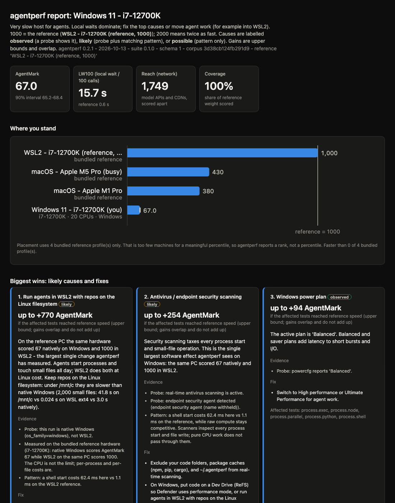

# agentperf

**How well does your computer serve AI coding agents — and why?**

The model runs in the cloud, but every tool call runs on your machine: shell
starts, file reads and edits, grep and ripgrep, git, tests, builds, file
transfer. agentperf times that work with fixed inputs, scores it against a
reference machine, and explains the score: which tests cost you points, what
is likely causing it, and what to fix first.



- **AgentMark** — the local-work score. 1000 = the reference (a desktop
  i7-12700K in WSL2); 2000 = twice as fast. The same PC scores **67** on
  native Windows with real-time antivirus — the report says why.
- **Reach** — the network score (model APIs, CDNs), kept separate because it
  measures a place and an ISP, not a machine.
- **LW100** — modelled seconds of local wait per 100 agent tool calls, from a
  real 6,416-call tool mix.
- **Biggest wins** — ranked causes with cited evidence (observed / likely /
  possible), concrete fixes, and upper-bound score gains.

Python 3.8+, standard library only. macOS, Linux, WSL2, and Windows.

## Install and run

Pick one. All three give the same `agentperf` command.

```sh
# 1) pipx (recommended) or pip
pipx install git+https://github.com/SergeSerb2/agentperf.git

# 2) single file, no install (download agentperf.pyz from the latest Release)
python3 agentperf.pyz run --quick

# 3) from a checkout
python3 -m agentperf run --quick
```

On Windows, use `py` or `python` instead of `python3`. In WSL, run it inside
the distro with repos on the Linux filesystem — never under `/mnt/c`.

```sh
agentperf doctor                                   # fast pre-flight, no benchmarks
agentperf run --quick --no-network                 # smoke run
agentperf run --fetch-tools --html report.html     # full run + explanatory report
agentperf run --runs 3                             # steadier number (single runs vary ~10-15%)
```

Then open the report and read **Biggest wins** first:

```sh
agentperf report agentperf-<label>-<stamp>.json    # or point it at any result
agentperf references                               # bundled machines you compare against
agentperf compare results/*.json --html compare.html
agentperf share <result>.json                      # anonymized copy, safe to post in an issue
```

An example report is in the repo: [examples/example-report.html](examples/example-report.html)
(open it in a browser).

## Run on other machines over SSH

agentperf copies itself as one `.pyz`, runs with the remote Python, and
fetches the result. POSIX hosts, Windows PowerShell SSH hosts, and WSL
distros through a Windows host all work.

```sh
agentperf remote my-mac --fetch-tools --clean
agentperf remote my-pc --fetch-tools
agentperf remote my-pc --wsl Ubuntu --fetch-tools
```

## What it measures

Fixed tests in seven scored categories — process spawn (weight 25), small
files (15), search (15), git (15), compute (15), file transfer (10), IPC (5) —
plus network (Reach) and diagnostics (login shell, PowerShell, harness
start-up, git fsmonitor) that feed the advice. Details, fairness rules
(equal flush semantics, cache bypass, pinned ripgrep), statistics, and
comparability rules: [docs/METHODOLOGY.md](docs/METHODOLOGY.md).

## Live agent runs (costs tokens)

```sh
agentperf live --dry-run
agentperf live --claude-model sonnet --codex-model gpt-5.6-sol
```

Three fixed tasks in a generated repo, run by real Claude Code / Codex
sessions. Each run reports success, wall time, local tool time, model time,
tool calls, and tokens. See SECURITY.md before you run it.

## Reading your score

- **850+** strong host · **550-850** usable, fixes help · **300-550** agents
  visibly wait on tools · **under 300** fix the top causes or move agent work.
- Causes are labelled **observed** (a probe shows it), **likely** (probe plus
  matching pattern), or **possible** (pattern only). Gains are upper bounds
  and overlap; they do not add up.
- Placement uses only the bundled profiles, so agentperf reports a rank, not
  a percentile. Four machines cannot support a percentile.
- Typical traps, all measured: antivirus/EDR and search indexing on Windows,
  repos on `/mnt/c` from WSL (2,000 files: 41.8 s vs 0.024 s on ext4), synced
  folders, slow shell dotfiles (paid per Codex command), background load,
  power plans, spinning disks.

## Privacy

A raw result contains your hostname, paths, and process names. Do not post
it. `agentperf share` writes an anonymized copy and lists every change.
See [SECURITY.md](SECURITY.md).

## Contributing

Add a benchmark with one decorated factory, contribute an anonymized
reference profile, or improve a diagnosis rule:
[CONTRIBUTING.md](CONTRIBUTING.md). Tests:
`python3 -m unittest discover -s tests -t .`

License: MIT. Not affiliated with any other project of a similar name.

## Roadmap

- Publish to PyPI as `agentperf` (the name is free; needs a maintainer
  PyPI account, so until then use the `git+https://` pipx install above).
- More bundled reference profiles (especially Linux desktops and laptops
  under no load), contributed with `agentperf share`.
- Opt-in result history on one machine, so a tuning change shows its own
  before/after instead of two loose JSON files.
